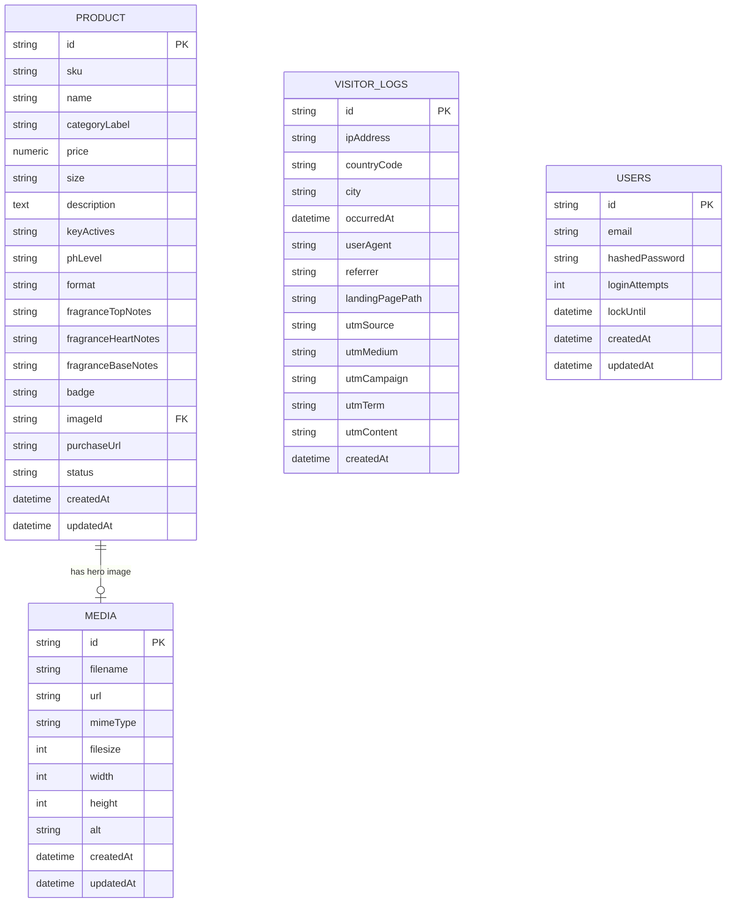
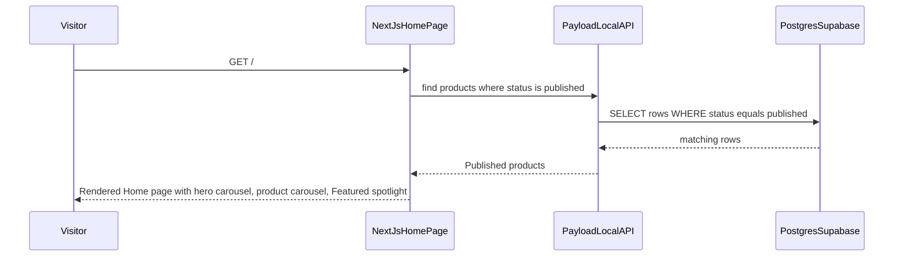
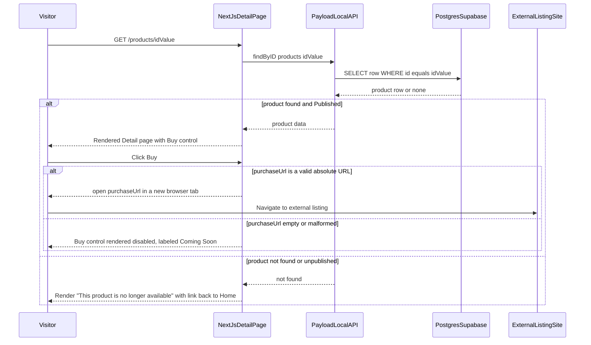
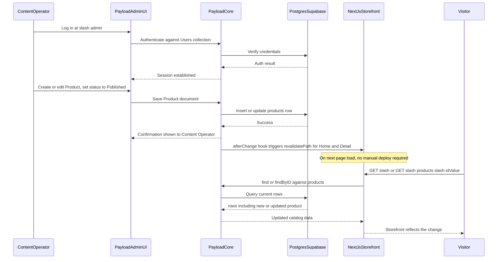
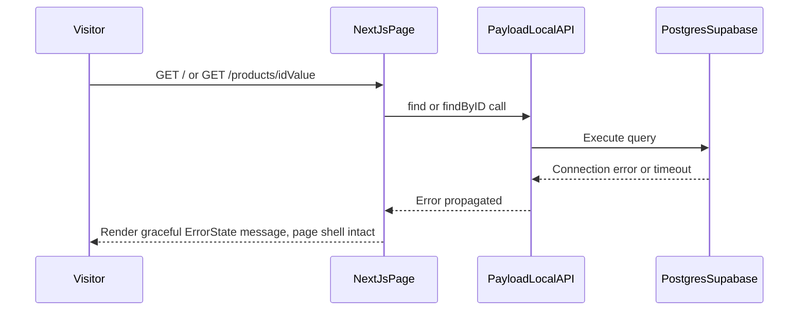
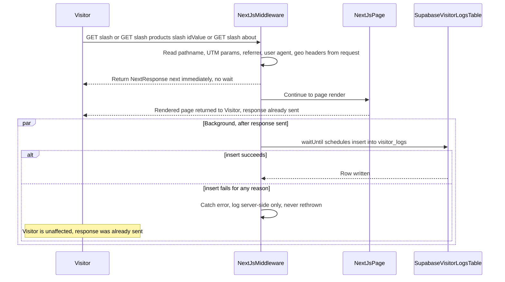
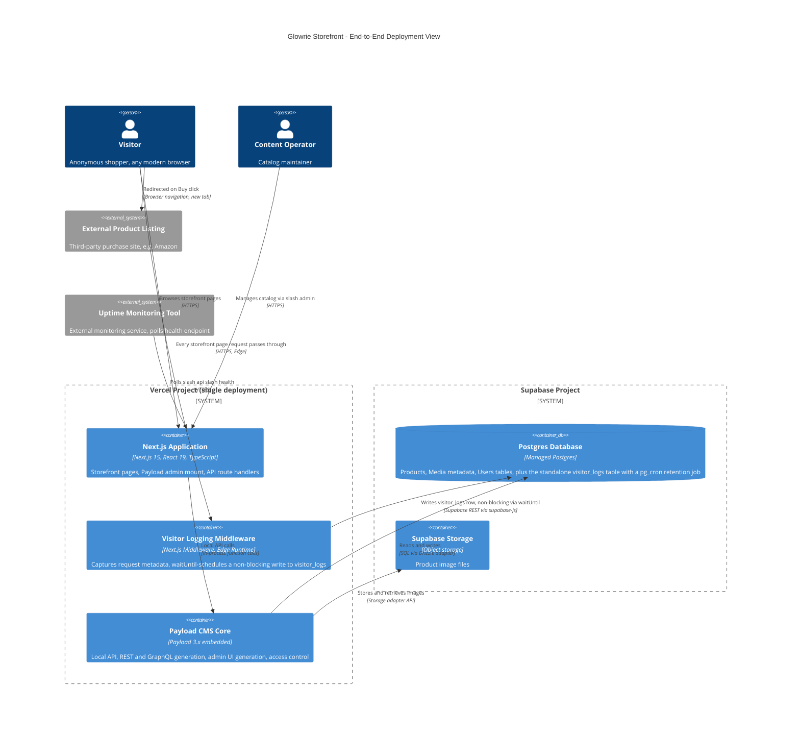
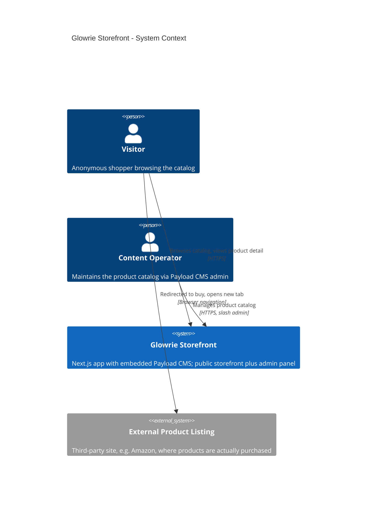
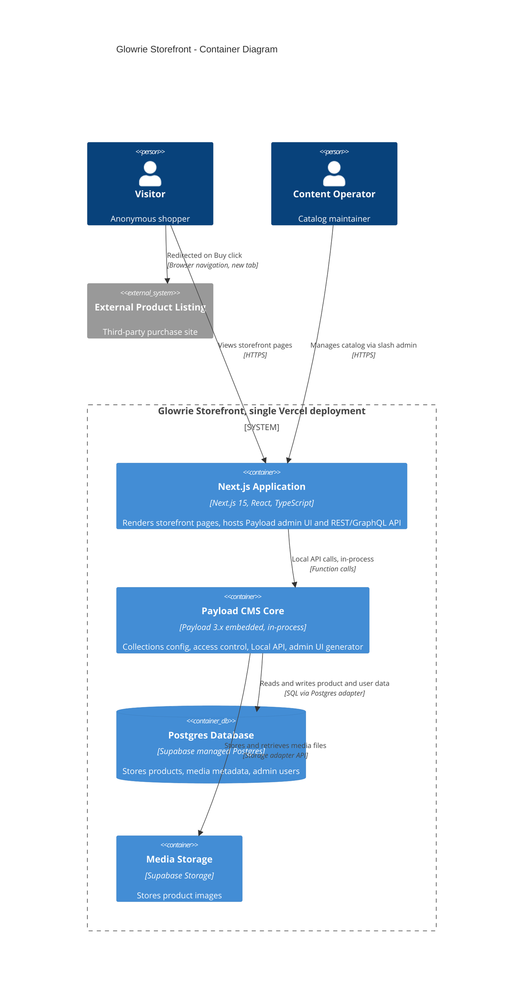
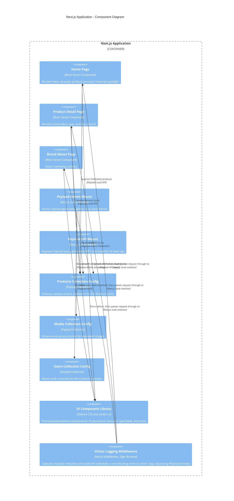

# Architecture Design Document

**Version:** 1.1 (Amendment — adds UC-006 Visitor Analytics/Tracking Logging, per `refined-prd.md` v2.1; supersedes v1.0)

## Create

| Harvey | User Name | Create Date |
|---|---|---|
| Harvey AI | Mohammad Taha | 2026-08-23 |

**Introduction:** Glowrie is a public product catalog storefront built as a single Next.js 15 application with Payload CMS 3.x embedded in-process (mounted at `/admin`), using Payload's Postgres adapter pointed at a managed Supabase Postgres database — a Modular Monolith with no separate backend service. This architecture supports the core problem statement (§3 of the PRD: no live storefront exists, and the Content Operator has no self-service publishing path) by giving Visitors a fast, anonymous Browse → Detail → Buy-redirect journey and giving the Content Operator a zero-deploy, CMS-native publishing workflow.

**v1.1 amendment note:** `refined-prd.md` was revised to v2.1 (re-signed-off, all 3 roles: PM, Engineering Lead, Design — 2026-08-23) after this architecture was originally approved, adding **UC-006 — Visitor Analytics/Tracking Logging**: passive, server-side capture of IP address, geolocation, timestamp, user agent, referrer, landing page path, and UTM parameters into a new `visitor_logs` table — a **direct Supabase/Postgres table, explicitly not a Payload CMS collection**. This v1.1 amendment extends the architecture to cover that requirement only; no previously-approved section is rewritten or reversed. Additions are tagged **(v1.1)** throughout this document. See new ADR-010/ADR-011 (Section 15) and Section 25 (Revision History) for full detail.

### Sign-Off

| Role | Approver Name | Status |
|---|---|---|
| Tech Lead / User | Mohammad Taha (2026-08-23) | Approved |

> v1.0 was approved by Mohammad Taha on 2026-08-23. v1.1 amendment re-approved by Mohammad Taha on 2026-08-23.

---

## 1. Technology Stack

`TECH_STACK: custom`

| Layer | Choice | Version | Notes |
|---|---|---|---|
| Frontend | Next.js (App Router, React Server Components) | Next.js 15.x, React 19.x, TypeScript 5.x | Same app also serves the CMS admin UI and API routes |
| CMS / Backend | Payload CMS (embedded, in-process — not a separate service) | Payload 3.x | Mounted at `/admin`; Local API used from React Server Components (no HTTP round-trip); REST + GraphQL auto-generated at `/api` |
| Database | Postgres | Managed via Supabase | Accessed through Payload's `@payloadcms/db-postgres` adapter (Drizzle-based) |
| Media Storage | Supabase Storage | — | Payload upload adapter target for product images |
| UI Component Library | Tailwind CSS + shadcn/ui | Tailwind 3.x, shadcn/ui (Radix UI primitives) | See Section 24 for full rationale and catalog |
| Hosting / Deployment | Vercel | — | Single deployment serves storefront + admin + API (see Section 8) |
| Repository Strategy | Single repo (monorepo) | — | One Next.js project; Payload config lives in the same codebase (`payload.config.ts`) |
| Package manager | pnpm | 9.x | Standard for Next.js + Payload 3.x starter templates |
| Direct DB client (visitor logging only) *(v1.1)* | `@supabase/supabase-js` | latest stable | Used **only** by the visitor-logging Middleware (Section 12, ADR-010) to write directly to `visitor_logs` — bypasses Payload's Local API/Drizzle adapter entirely; fetch-based and Edge-Runtime-compatible, unlike Payload's Node-only Postgres driver |
| Scheduled job (retention/purge only) *(v1.1)* | Supabase `pg_cron` extension | Postgres-native | Runs the `visitor_logs` 180-day retention/auto-purge job (Section 9, ADR-011) — no separate cron service introduced |
| **QA automation framework (browser E2E):** | **Playwright** | latest stable | Confirmed default; see Section 14 |

**User QA methodology choice:** `sdet-test-automation`

> Non-iTN custom stack. The user explicitly confirmed Playwright as the browser E2E framework (Q3), so per QA methodology routing rules the paired methodology is `sdet-test-automation` (Playwright + Page Object Model), not `tester` and not `selenium-automation`.

**Mock-data engine note:** Per Harvey's UI Mock/Data Strategy, a runnable UI app must not use inline/hardcoded mock data as its data source. This does **not** require the `intops-eng-data-engine` here: Payload CMS + Postgres/Supabase **is** the real backend and is built immediately in Sprint 0/1 of the development plan, so Code mode wires the storefront directly to real Payload collections from the first coding sprint — there is no intermediate mock-API phase to bridge. (The UX Design phase's static-HTML prototype with an in-page `MOCK_PRODUCTS` array was a separately sanctioned exception — a throwaway, no-build, no-API-tier prototype — and does not carry forward into Code.)

---

## 2. Architectural Pattern

**Pattern: Modular Monolith.**

**Justification:**
- Scope is small (3 public screens, 1 core CMS-managed entity, no auth system to build, no payments) — PRD §7 rates this "low-to-moderate complexity."
- Payload CMS 3.x is designed to run embedded inside a Next.js app in the same process (Local API calls avoid HTTP overhead for Server Components) — this is the officially supported "Next.js + Payload" pattern, not a workaround.
- A single deployable unit (one Vercel project) is simpler to build, deploy, operate, and monitor than a separate Node/Express API + separate Payload instance, with no loss of capability for this scope.
- Internal module boundaries (Storefront UI, CMS Collections, Access Control, Shared UI) still exist and are enforced by folder structure and Payload's collection-config pattern (Section 3) — "Modular Monolith" describes internal separation-of-concerns, not lack of structure.

**Repository Strategy:** Single repo (monorepo) — confirmed by user (Q2). One Git repository, one Vercel project, one commit/PR per sprint. This subsection is informational since the pattern is Modular Monolith (not Decoupled Fullstack), but is recorded here because Plan and Code stages reference `repoStrategy` from pipeline state.

---

## 3. Module Design

| Module | Type | Responsibility | Key Interfaces |
|---|---|---|---|
| **Storefront UI** | Domain | Renders Home, Product Detail, Brand/About pages (React Server Components); client-side carousel/nav interactivity | Next.js App Router pages under `src/app/(storefront)/` |
| **Payload Collections** | Domain | Defines the `Products`, `Media`, `Users` collection schemas, field validation, and access-control rules | `src/collections/*.ts`, consumed by Payload core |
| **Payload Core (embedded)** | Infrastructure | Payload's runtime: Local API, REST/GraphQL API generation, admin UI generation, auth | `payload.config.ts`; mounted via Next.js route handlers at `/admin/[[...segments]]` and `/api/[...slug]` |
| **Data Access** | Infrastructure | Postgres adapter (Drizzle-based), connection pooling, migrations | `@payloadcms/db-postgres` adapter config |
| **Media Storage Adapter** | Infrastructure | Uploads/serves product images via Supabase Storage | Payload upload plugin config |
| **Shared UI Library** | Shared | Design-system-driven presentational components (ProductCard, Carousel, SpecTable, Nav, ErrorState, etc.) | `src/components/**` — see Section 24 |
| **Shared Utilities** | Shared | INR currency formatting, absolute-URL validation (`isValidAbsoluteUrl`), shared TypeScript types generated from Payload config | `src/lib/**` |
| **Visitor Analytics Logging** *(v1.1)* | Cross-cutting / Infrastructure | Captures passive request metadata (IP, geolocation, UA, referrer, landing path, UTM params) on every storefront page load and writes it directly to `visitor_logs` in Supabase Postgres — entirely bypasses the Payload Collections/Payload Core modules above | `src/middleware.ts` (Next.js Middleware); `src/lib/visitor-logging.ts` (Supabase insert helper) — see Section 12, ADR-010 |

---

## 4. Domain Model

Conceptual entities (aligned with PRD §9 and Domain Glossary §16):

- **Product** — the central sellable-item concept: identity (SKU), presentation (name, image, badge), commercial data (price in INR), descriptive data (description, size), technical data (pH level, format, key actives), sensory data (fragrance top/heart/base notes), an external commerce pointer (`purchaseUrl`), and a lifecycle state (`status`: Draft/Published).
- **Media** — a supporting entity: the image asset referenced by a Product's hero/card image. Not a first-class business concept in the PRD, but required physically because Payload models uploads as their own collection.
- **Content Operator (as a system actor, not a domain entity)** — represented physically as a `Users` (Payload auth) record; not a "business domain" concept, purely an access-control actor.
- **Brand/About Content** — explicitly **not** a domain entity (PRD §9: "confirmed not modeled as a dynamic/CMS-managed entity"). Static content, developer-maintained in the Next.js codebase (e.g. hardcoded JSX/MDX), out of the data model entirely.
- **`visitor_logs` (system-generated log object, not a domain entity)** *(v1.1)* — mirrors PRD §9's framing exactly: an append-only operational/log record of a page view (IP, geolocation, timestamp, user agent, referrer, landing page path, UTM parameters), **not** a business concept a Visitor or Content Operator directly creates, edits, or views in-app. Written directly to Postgres by the Visitor Analytics Logging module, independent of the Payload Collections layer (Section 3).

**Relationships:** Product *has one* Media (hero image) — 1:1 for this release (no image gallery in scope). No other domain relationships exist — there is no Cart, Order, or User-Product relationship of any kind (PRD §9 "Removed Entities": Cart and CartLineItem are explicitly out of scope). `visitor_logs` *(v1.1)* has **no foreign-key relationship** to Product, Media, or Users — it is a standalone, unrelated table by design (it logs anonymous page views, not identified users or product interactions).

---

## 5. Data Model Diagram (ERD)



`USERS` has no direct relationship to `PRODUCT` — admin authentication is orthogonal to the Product/Media data model (Payload enforces access control in code, not via a foreign key). `VISITOR_LOGS` *(v1.1)* likewise has **no relationship** to any other entity in this diagram — it is a standalone, unrelated table by design (Section 4).

---

## 6. Database Schema

**Migration strategy (required):** Payload's Postgres adapter (`@payloadcms/db-postgres`, built on Drizzle ORM) generates and manages schema migrations. Migrations are created with `payload migrate:create` during development and applied with `payload migrate` as a pre-deploy build step on Vercel (runs before `next build` in the build command). No manual SQL migrations are hand-written; Payload's collection config (`src/collections/*.ts`) is the single source of truth for schema, and Drizzle diffs against it to generate migration files, which are committed to the repo.

**Migration strategy exception — `visitor_logs`** *(v1.1)*: Because `visitor_logs` is explicitly **not** a Payload collection (PRD §9), it falls outside Payload's collection-config-driven Drizzle migration pipeline above. It is created and evolved via a **hand-written plain SQL migration** (e.g. a Supabase CLI migration file, `supabase/migrations/<timestamp>_create_visitor_logs.sql`, or an equivalent versioned `.sql` file applied through the Supabase dashboard/CLI), committed to the repo alongside the Payload-generated migrations but run through Supabase's own migration tooling, not `payload migrate`. This is the one deliberate exception to the "single source of truth via Payload config" rule stated above, and is called out explicitly so Code mode does not attempt to model `visitor_logs` as a Payload collection.

**PRODUCTS:** *Purpose: the catalog of sellable items; the single CMS-managed business entity in this release.*

| Column | Type | Constraints | Purpose (business meaning) |
|---|---|---|---|
| id | UUID | PK, NOT NULL, default gen_random_uuid() | Surrogate key |
| sku | VARCHAR(32) | UNIQUE, NOT NULL | Product code shown on catalog cards (e.g. "GL-01") |
| name | VARCHAR(255) | NOT NULL | Product display name |
| category_label | VARCHAR(64) | NULL | Short overline label (e.g. "Body Cleanser") |
| price | NUMERIC(10,2) | NOT NULL | Price in INR (₹); no currency column — single-currency release |
| size | VARCHAR(64) | NULL | e.g. "500ml / 16.9 fl oz" |
| description | TEXT | NOT NULL | Long-form marketing/product copy |
| key_actives | TEXT | NULL | Short list, rendered as card subtitle and in Technical Specs |
| ph_level | VARCHAR(32) | NULL | e.g. "5.5 – 6.0" |
| format | VARCHAR(64) | NULL | e.g. "Viscous Gel" |
| fragrance_top_notes | TEXT | NULL | Includes implied timing window (e.g. "0–15 minutes") |
| fragrance_heart_notes | TEXT | NULL | e.g. "15–60 minutes" |
| fragrance_base_notes | TEXT | NULL | e.g. "1–6 hours" |
| badge | VARCHAR(16) | NULL, CHECK IN ('NEW','BESTSELLER') | Optional catalog-card badge |
| image_id | UUID | FK → media(id), NOT NULL | Product hero/card image |
| purchase_url | TEXT | NULL, validated at write-time (see below) | External listing URL; Buy button gating condition (UC-003) |
| status | VARCHAR(16) | NOT NULL, CHECK IN ('draft','published'), default 'draft' | Storefront visibility gate (UC-001 Business Rule) |
| created_at | TIMESTAMPTZ | NOT NULL, default now() | Record creation time |
| updated_at | TIMESTAMPTZ | NOT NULL, default now(), auto-updated | Last modification time |

**Indexes:** `status` (partial index `WHERE status = 'published'` — every storefront query filters on this), `sku` (unique, already covered by UNIQUE constraint).

**Field-level validation (Payload `validate` function on `purchase_url`):** Rejects non-absolute-URL strings at write time in the admin UI, directly implementing the PRD §9 UC-003 AC4 recommendation ("Payload CMS field-level URL validation should prevent this at entry time"). The storefront's `isValidAbsoluteUrl()` runtime check (Section 11) remains as defense-in-depth for any record written before this validator existed or via direct API access.

**MEDIA:** *Purpose: uploaded image assets, Payload's standard upload collection.*

| Column | Type | Constraints | Purpose (business meaning) |
|---|---|---|---|
| id | UUID | PK, NOT NULL | Surrogate key |
| filename | VARCHAR(255) | NOT NULL | Original uploaded filename |
| url | TEXT | NOT NULL | Public URL served from Supabase Storage |
| mime_type | VARCHAR(64) | NOT NULL | e.g. "image/webp" |
| filesize | INTEGER | NOT NULL | Bytes |
| width | INTEGER | NULL | Pixels, for `next/image` layout |
| height | INTEGER | NULL | Pixels, for `next/image` layout |
| alt | VARCHAR(255) | NULL | Accessibility alt text (WCAG 2.1 AA requirement, Section 9) |
| created_at | TIMESTAMPTZ | NOT NULL | — |
| updated_at | TIMESTAMPTZ | NOT NULL | — |

**USERS:** *Purpose: Content Operator admin authentication accounts (Payload's built-in auth-enabled collection).*

| Column | Type | Constraints | Purpose (business meaning) |
|---|---|---|---|
| id | UUID | PK, NOT NULL | Surrogate key |
| email | VARCHAR(255) | UNIQUE, NOT NULL | Login identifier |
| hashed_password | VARCHAR(255) | NOT NULL | bcrypt hash (Payload default) |
| login_attempts | INTEGER | NOT NULL, default 0 | Brute-force lockout counter (Payload built-in) |
| lock_until | TIMESTAMPTZ | NULL | Account lockout expiry |
| created_at | TIMESTAMPTZ | NOT NULL | — |
| updated_at | TIMESTAMPTZ | NOT NULL | — |

> Payload also auto-manages internal bookkeeping tables (`payload_preferences`, `payload_migrations`) not listed above — these are framework-internal, not part of the business domain model.

**VISITOR_LOGS** *(v1.1 — new)*: *Purpose: an append-only operational log of storefront page views for marketing/traffic attribution (UC-006). Written directly to Postgres, independent of Payload — not a Payload collection, not visible in `/admin`.*

| Column | Type | Constraints | Purpose (business meaning) |
|---|---|---|---|
| id | UUID | PK, NOT NULL, default gen_random_uuid() | Surrogate key |
| ip_address | INET | NOT NULL — **[PII]** | Visitor's source IP address (Postgres native `INET` type — supports both IPv4 and IPv6, more correct than a plain string column) |
| country_code | VARCHAR(2) | NULL — **[PII]** | ISO country code derived from the `x-vercel-ip-country` request header; null when unavailable (UC-006 AC3) |
| city | VARCHAR(128) | NULL — **[PII]** | Derived from the `x-vercel-ip-city` request header; null when unavailable (UC-006 AC3) |
| occurred_at | TIMESTAMPTZ | NOT NULL, default now() | Time of the page request (maps to PRD §9 `timestamp` field; renamed to avoid the SQL reserved word `timestamp` as a column identifier) |
| user_agent | TEXT | NULL | Raw `User-Agent` request header |
| referrer | TEXT | NULL | Raw `Referer` request header; null for direct navigation (UC-006 AC4) |
| landing_page_path | VARCHAR(512) | NOT NULL | The storefront path requested (e.g. `/`, `/products/gl-01`, `/about`) |
| utm_source | VARCHAR(255) | NULL | From `utm_source` query parameter, if present |
| utm_medium | VARCHAR(255) | NULL | From `utm_medium` query parameter, if present |
| utm_campaign | VARCHAR(255) | NULL | From `utm_campaign` query parameter, if present |
| utm_term | VARCHAR(255) | NULL | From `utm_term` query parameter, if present |
| utm_content | VARCHAR(255) | NULL | From `utm_content` query parameter, if present |
| created_at | TIMESTAMPTZ | NOT NULL, default now() | Row insert time (system) — also the column the retention/auto-purge job filters on |

**Indexes:** `created_at` (B-tree — supports the retention/auto-purge job's `WHERE created_at < now() - interval '180 days'` filter at low-thousands-of-rows/day scale, Section 9). No other indexes — this table has no query API (write-only per PRD §9) so no read-path index is needed.

**Row Level Security (RLS):** Enabled with a default-deny policy — no `anon` or `authenticated` Postgres role may `SELECT`, `INSERT`, `UPDATE`, or `DELETE` on `visitor_logs`. Only the `service_role` key (used exclusively server-side by the Middleware, Section 12/ADR-010) can write, and only the scheduled `pg_cron` job (running with elevated Postgres privileges inside the database itself, Section 9/ADR-011) can delete. This directly implements the PRD §12 v1.1 Security requirement: *"no client-side/browser exposure of this table or its contents at any point."*

**Write path:** Exclusively via the Visitor Analytics Logging module (Section 3) — no Payload access-control rule applies here since Payload never touches this table (Section 7 below).

---

## 7. API Strategy

**Style:** REST (Payload auto-generated) + GraphQL (Payload auto-generated, available but not required by this storefront) for the CMS-managed `Products`/`Media` collections. React Server Components on the storefront pages call Payload's **Local API** directly (in-process function calls, e.g. `payload.find({ collection: 'products', where: { status: { equals: 'published' } } })`) — **not** an HTTP round-trip — for performance, since both run in the same Next.js process.

**Key endpoints (REST, auto-generated by Payload from the `Products` collection config):**

| Endpoint | Method | Purpose | Auth |
|---|---|---|---|
| `/api/products?where[status][equals]=published` | GET | List Published products (used by any client-side/ISR revalidation consumer; RSC uses Local API instead) | None (public read) |
| `/api/products/:id` | GET | Single product by id | None (public read; access-control rule hides Draft docs from anonymous reads) |
| `/api/products` | POST | Create product | Payload admin session (Content Operator) |
| `/api/products/:id` | PATCH | Update product | Payload admin session |
| `/api/products/:id` | DELETE | Delete product | Payload admin session |
| `/api/media` | POST | Upload image | Payload admin session |
| `/api/users/login` | POST | Content Operator login | Public (credentials-based) |
| `/api/health` | GET | Liveness/readiness probe (custom route, Section 12) | None |

**Versioning strategy:** No external third-party consumes this API today (PRD §10: "Exposed: None"). Payload's default collection routes (`/api/{collection}`) are treated as an internal-only contract for this release — no `/api/v1/` prefix is introduced now. If a future phase exposes this API to external consumers, introduce explicit `/api/v2/` custom route handlers rather than retrofitting versioning onto Payload's default routes, preserving backward compatibility for the admin UI (which depends on the default routes).

**`visitor_logs` has no API surface** *(v1.1)*: No REST, GraphQL, or Payload-admin route exists for `visitor_logs` — consistent with PRD §9 ("write-only/append-only... no in-app reporting dashboard, admin UI, or query interface is being built"). The only write path is the Middleware described in Section 12; the only read path is direct Supabase console/SQL access by an authorized operator, entirely outside this application's API layer.

---

## 8. Deployment

**Targets:** Vercel (single project) for the Next.js application (storefront + `/admin` + `/api`); Supabase (managed Postgres + Storage) for data and media.

**Environments:**

| Environment | Frontend/App | Database | Notes |
|---|---|---|---|
| Local dev | `next dev` on localhost | Local Postgres via Supabase CLI (`supabase start`) or a dev Supabase project | Payload admin at `http://localhost:3000/admin` |
| Staging (optional, recommended) | Vercel Preview deployment per PR | Separate Supabase project or branch | Used for Content Operator UAT before promoting a sprint |
| Production | Vercel Production deployment | Production Supabase project | Public storefront + live admin |

**Secrets management:** All secrets (`DATABASE_URI`, `PAYLOAD_SECRET`, Supabase Storage credentials, and *(v1.1)* `SUPABASE_SERVICE_ROLE_KEY` — used exclusively by the visitor-logging Middleware, Section 12/ADR-010) are stored as encrypted Vercel Environment Variables, scoped per environment (Development/Preview/Production). Never committed to the repo; `.env.example` documents required keys with placeholder values only; `.env` is gitignored. `SUPABASE_SERVICE_ROLE_KEY` *(v1.1)* must **never** be prefixed `NEXT_PUBLIC_` and must never be referenced from any client component — it is a server-only, high-privilege credential (Section 10).

**Infrastructure approach:** No IaC/Terraform/K8s needed at this scale — Vercel project settings + Supabase project settings are configured directly (Vercel dashboard/CLI, Supabase dashboard/CLI). Build command runs `payload migrate` before `next build` so schema is always current before the new build serves traffic.

**One-time per-environment setup** *(v1.1)*: Two additional one-time steps are required per environment (local, staging, production) beyond the existing Payload/Vercel setup above: (1) apply the `visitor_logs` SQL migration (Section 6) via Supabase CLI/dashboard; (2) enable the `pg_cron` extension in the Supabase project (one-click in the Supabase dashboard's Database → Extensions panel, or `CREATE EXTENSION IF NOT EXISTS pg_cron;`) and register the retention job (Section 9/ADR-011). Both are Supabase-project-level settings, not part of the Next.js build — no `payload migrate` dependency.

---

## 9. NFRs & Architecture

Maps each PRD §12 Non-Functional Expectation to an architectural decision:

| NFR (PRD §12) | Target | Architectural Decision |
|---|---|---|
| Performance | Home LCP < 2.5s on simulated 4G; interaction latency < 200ms | `next/image` automatic optimization for product/hero images; Payload Local API (no HTTP round-trip for RSC data fetch); ISR (`revalidate`) on Home/Detail pages with on-demand revalidation triggered by a Payload `afterChange` hook on `Products` (calls Next.js `revalidatePath`) so publish-to-live latency (KPI in PRD §4) stays near-instant without full rebuilds; partial index on `products.status` |
| Scalability | ≥500 concurrent visitors; catalog grows 4 → ~50 products in 12 months | Vercel serverless auto-scaling (stateless RSC rendering); Supabase connection pooling (PgBouncer/Supavisor) to avoid connection exhaustion under serverless concurrency; all product queries are paginated/filtered (never a hardcoded `LIMIT 4`), carousel component accepts arbitrary item counts |
| Availability | ≥99.5% uptime | Vercel + Supabase managed-platform SLAs; `/api/health` liveness route (Section 12) for external uptime monitoring (specific monitoring tool selection is left to the deployment plan, per PRD §4) |
| Security | OWASP Top 10; HTTPS enforced; no PCI-DSS scope | Vercel automatic TLS termination; Payload's parameterized-query ORM (Drizzle) eliminates SQL injection risk; input validation on all Payload fields (including `purchase_url` — see Section 6); no payment/cart data ever touches this system (see Section 10) |
| Accessibility | WCAG 2.1 AA | shadcn/ui components built on Radix UI primitives (accessible-by-default: keyboard nav, ARIA roles/focus management); PRD-flagged remediation item (icon-only nav buttons lacking labels in the raw mockup) is explicitly fixed in Section 24's shared Nav component with `aria-label` on every icon-only control |
| Platform support | Latest 2 versions of Chrome/Firefox/Safari/Edge; responsive 4/8/12-col breakpoints | Tailwind CSS responsive utilities mirror the exact breakpoints from the Golden Alchemist design tokens (Section 24); no browser-specific polyfills needed for Next.js 15's target baseline |
| Internationalization | Not required (English, INR only) | No i18n library added; a single `formatINR()` utility centralizes currency formatting so a future i18n pass has one integration point, not one per component |
| Batch/throughput *(v1.1 — amended)* | N/A for Product/CMS data; *(v1.1)* the `visitor_logs` retention/auto-purge job runs on a daily schedule at low-thousands-of-rows/day expected volume | Supabase `pg_cron` scheduled SQL job (ADR-011) — a lightweight daily `DELETE` at off-peak hours, no separate batch-processing service needed at this volume |
| **Compliance & Privacy** *(v1.1 — new)* | India's DPDP Act (2023) applies since `visitor_logs`' `ipAddress`/`countryCode`/`city` are tagged **[PII]** (PRD §12); requires (1) a footer privacy notice on every storefront page, (2) a 180-day rolling retention with automated auto-purge | Footer privacy notice: static text/link in the shared `Footer` component (Section 24), present on every storefront page (Home, Detail, Brand/About) — no cookie-consent banner needed since this is passive server-side logging, not client-side cookies/tracking scripts; retention: Supabase `pg_cron` daily purge job (ADR-011) deletes `visitor_logs` rows where `created_at < now() - interval '180 days'` |

---

## 10. Security Architecture

**Authentication:** Content Operator authenticates via Payload's built-in `Users` collection (`auth: true`), using email + bcrypt-hashed password, session-cookie-based (Payload's default JWT-in-httpOnly-cookie strategy). Login-attempt lockout is enabled via Payload's built-in `loginAttempts`/`lockUntil` fields (Section 6) to mitigate brute-force attempts on `/admin` and `/api/users/login`.

**Authorization (access control):** Payload's per-collection `access` functions enforce:
- `Products.read`: public (unauthenticated) requests may only read documents where `status === 'published'`; authenticated admin sessions may read all (Draft + Published) — this is the code-level enforcement of PRD §9's "Visitor = read-only, Published products only."
- `Products.create` / `update` / `delete`: require an authenticated admin session (`req.user` present) — Content Operator only; no additional role tiers exist for this release (PRD §7: "single operator role").
- `Media.*`: same authenticated-write / public-read pattern as Products.
- `Users.*`: no public read or create — admin accounts are provisioned out-of-band (Payload seed script / direct DB), not via public sign-up (no accounts feature exists for Visitors per PRD scope).

**No Visitor authentication exists** — Visitor is anonymous by design (PRD §6, §13: "Login screen: N/A"). This is not the iTN `itn-loginv2`/`AuthGuard` pattern (non-iTN stack); it applies only to Content Operator via Payload's native admin auth, which is out of this project's custom-build scope (PRD §9: "existing auth, out of this PRD's scope" — Payload provides it as a framework feature, not custom-built here).

**Encryption:** HTTPS enforced end-to-end via Vercel's automatic TLS (PRD §12). Data at rest encrypted by Supabase's managed Postgres (platform-level encryption at rest). `PAYLOAD_SECRET` (used to sign auth tokens) stored as a Vercel encrypted environment variable, never in code.

**Audit logging:** Payload's default `updatedAt`/`createdAt` timestamps provide basic change tracking on Products. No dedicated audit-log table is introduced for this release — proportionate to a single-operator, single-role system with no compliance mandate (PRD §12: "PCI-DSS entirely out of scope"; no PII is collected anywhere in the Product/Media/Users data model per §9).

**Compliance:** No PII is collected via the Product/Media/Users data model or any Visitor-facing form (Visitor remains anonymous for Browse/Detail/Buy — UC-001 through UC-004). No payment/cardholder data ever enters this system (Buy is a stateless client-side redirect, Section 11). Standard OWASP Top 10 web-application practices apply generically (input validation via Payload field schemas, no raw SQL string concatenation, dependency scanning as part of CI per the Code-mode quality gates). **(v1.1 correction)** This blanket "no PII" statement no longer holds for the `visitor_logs` entity introduced by UC-006 — see the dedicated subsection below.

**`visitor_logs` PII & DPDP Act compliance** *(v1.1 — new)*: `ipAddress`, `countryCode`, and `city` on `visitor_logs` are tagged **[PII]** (PRD §9) — under India's Digital Personal Data Protection Act (DPDP Act, 2023), IP address and derived geolocation can constitute personal data. Architectural controls:
- **Access control:** RLS default-deny on `visitor_logs` (Section 6) — only the server-side `service_role` key (used exclusively by the Middleware, never exposed to the browser) can insert; only the `pg_cron` job can delete. No API route, GraphQL field, or Payload admin screen ever surfaces this table (Section 7) — directly satisfies PRD §12 v1.1: *"no client-side/browser exposure of this table or its contents at any point."*
- **Data minimization:** Only the fields explicitly required for marketing/traffic attribution are captured (Section 6) — no additional fingerprinting, no cross-site tracking identifiers, no cookies.
- **Retention:** 180-day rolling retention with automated `pg_cron` purge (Section 9/ADR-011) rather than indefinite storage.
- **Transparency:** A footer privacy notice is shown on every storefront page (Section 24) acknowledging that visit data is logged for marketing/traffic-analysis purposes (UC-006 AC7) — no cookie-consent banner is required since this is passive server-side logging, not client-side cookies/tracking scripts.
- **Known residual risk (carried from PRD, not resolved by architecture):** Whether DPDP obligations extend beyond a privacy notice + retention limit (e.g. a right-to-erasure channel, formal DPIA) has not had legal/domain-expert review — flagged `[Domain Expert Review Recommended]`. Deferred — Reason: formal legal/DPDP review is explicitly acknowledged and deferred by the user (PRD §15 OQ-11, BLOCKED) — this is a learning project; will revisit if it ever moves toward real production/commercial use. This architecture implements the PRD's stated good-faith measures only; it does not independently expand compliance scope beyond what the PRD specifies. See Section 16 Risks.

---

## 11. Error Handling & Resilience

Maps each PRD §11 scenario to an architectural response:

| PRD §11 Scenario | Architectural Response |
|---|---|
| Payload CMS/backend unreachable | RSC data-fetch wrapped in try/catch; on failure, render a dedicated error UI state (`ErrorState` shared component, Section 24) instead of throwing — Next.js `error.tsx` boundary as a last-resort fallback per route segment. No automatic retry against Postgres from the client (would not help a real outage); a health-check route (Section 12) supports external alerting instead |
| Product not found (deleted/unpublished/stale link) | Payload `findByID` returning null (or an access-control 403 for a Draft doc requested anonymously) is treated identically by the Detail page: render "This product is no longer available" + link back to Home (UC-002 AC2) — not a generic 404 |
| `purchaseUrl` not yet set | Buy button rendered in a disabled state ("Coming Soon") — a pure UI-layer conditional (`purchaseUrl` falsy), no server error involved (UC-003 AC3) |
| `purchaseUrl` malformed | `isValidAbsoluteUrl()` shared utility (Section 3) runs client-side before rendering the Buy button as enabled; a malformed value is treated identically to an unset one (disabled "Coming Soon") — defense-in-depth alongside the Section 6 field-level validator that should prevent this at entry time |
| Static asset (image) failure on Brand/About | Since Brand/About content is static (not CMS-fetched), "failure" here means a broken image reference; `next/image` renders its blur-placeholder/alt-text fallback and the surrounding page shell (nav/footer) is unaffected because it's a separate component tree, not coupled to the image's load state |
| *(v1.1)* Vercel geolocation headers absent/unavailable when logging a page view (e.g. local dev, or any request bypassing Vercel's edge network) | `visitor_logs.country_code`/`city` stored as `NULL`; the row is still written and the page renders normally — never a blocking or fatal condition (UC-006 AC3) |
| *(v1.1)* No `Referer` header present (direct navigation / typed URL / bookmark) | `visitor_logs.referrer` stored as `NULL`; not treated as an error (UC-006 AC4) |
| *(v1.1)* No UTM query parameters present on the request | All `visitor_logs.utm_*` columns stored as `NULL` — the normal, expected case for organic traffic, not an error condition (UC-006 AC5) |
| *(v1.1)* `visitor_logs` write to Supabase fails (timeout, connection error, RLS misconfiguration, etc.) | **The page still renders normally for the Visitor, with zero visible delay or error** — the insert runs inside a `waitUntil()`-scheduled promise (Section 12) that executes only *after* the response has already been returned; the promise is wrapped in try/catch and any failure is written only to server-side function logs, never surfaced to the Visitor or capable of blocking/delaying the response (UC-006 AC6 — this is the architecture's primary answer to the "must never block page render" constraint) |

**Timeouts/circuit breakers:** No external service calls exist beyond Postgres (Local API, same process) and Supabase Storage (image serving, CDN-backed) — there is no third-party API integration requiring a circuit breaker in this release (Section 13). Postgres query timeout is configured at the Payload/Drizzle adapter level (default driver timeout) to prevent a hung connection from blocking a request indefinitely.

**Graceful degradation:** ISR (Section 9) means a transient backend blip during a `revalidate` window can still serve the last successfully cached page rather than an error, for Home and Detail — an additional resilience benefit beyond the explicit PRD error states.

---

## 12. Cross-Cutting Concerns

**Logging:** Structured logging via Payload's built-in Pino logger (Payload 3.x default) for CMS-side operations (auth attempts, collection writes); Vercel's built-in function logs capture RSC/route-handler output. No external log aggregation service is added in this release (proportionate to scale) — noted as a future enhancement in Section 16 Risks.

**Monitoring/Observability:** Vercel Analytics (built into the hosting platform, zero extra integration) for traffic and Core Web Vitals (directly measures the PRD §12 LCP target). No APM/tracing tool (e.g. Sentry/Datadog) is added for this release — out of scope per user's explicit "no external integrations beyond PRD scope" answer (Q7); Deferred — Reason: not a gap, a scoped-out future enhancement (see Section 16 risk register).

**Health/readiness endpoints:** `GET /api/health` — a lightweight custom Next.js route handler that performs a trivial Payload Local API call (e.g. `payload.find({ collection: 'products', limit: 1 })`) and returns 200/503, giving the uptime-monitoring tool referenced in PRD §4 KPI table something concrete to poll.

**Visitor Analytics/Tracking Logging (UC-006)** *(v1.1 — new)*

**Where in the request lifecycle this happens — architectural decision:** Logging is implemented in **Next.js Middleware** (`src/middleware.ts`, Edge Runtime), matched against the three storefront routes (`/`, `/products/:path*`, `/about`), using the Edge platform's `NextFetchEvent.waitUntil()` API. This is the standard, Vercel-documented pattern for "log analytics data without blocking the response," and it directly satisfies the PRD's hard constraint (UC-006 business rule: *"must never block, delay, or fail the actual page render"*):

1. Middleware receives the incoming `NextRequest` and immediately reads all needed metadata synchronously off the request object — pathname (`request.nextUrl.pathname`), UTM query params (`request.nextUrl.searchParams`), `Referer` and `User-Agent` headers, and Vercel's platform-injected geolocation headers (`x-vercel-ip-country`, `x-vercel-ip-city`) plus the client IP.
2. Middleware returns `NextResponse.next()` **immediately** — the Visitor's page continues rendering/streaming with zero added latency from logging.
3. In the same middleware invocation, `event.waitUntil(logVisitorPageView(metadata))` schedules the actual Supabase insert (via `@supabase/supabase-js`, Section 1) to run **after** the response has already been sent — this is the mechanism that guarantees "never blocks or delays" (AC1) rather than merely "usually fast."
4. `logVisitorPageView()` (`src/lib/visitor-logging.ts`) wraps the insert in try/catch; on failure it only `console.error`s (captured by Vercel's function logs, Section 12 above) — it never throws in a way that could surface to the Visitor, since by the time it runs the response is already gone (AC6).

**Alternatives considered (see ADR-010 for full comparison):** (a) a Payload `afterChange`-style hook — not applicable, since `visitor_logs` is explicitly not a Payload collection and this event fires on every page *view*, not on a CMS write; (b) logging inside the Home/Detail/About Server Components using Next.js 15's `after()` API — viable and equally non-blocking, but would require duplicating the capture call in three separate page/layout files instead of one central Middleware matcher; (c) a synchronous `await` insert before rendering — rejected outright, as it would violate the "must never block" constraint by definition.

**Why Middleware over `after()` in a shared layout:** Middleware gives a single integration point (one file, one route matcher) that automatically covers Home, Detail, and Brand/About without touching the page/layout components at all — lower risk of a future new storefront route silently missing the logging call, since it's enforced by the matcher config rather than by every page remembering to invoke it.

**Retention & automated purge (UC-006 AC8)** *(v1.1 — new)*: Implemented as a Supabase `pg_cron` scheduled job (Postgres-native, enabled as a project extension — Section 8), not a Vercel Cron Job or external scheduler. Runs daily during a low-traffic window and deletes any `visitor_logs` row where `created_at` is older than 180 days:

```sql
SELECT cron.schedule(
  'purge-visitor-logs',
  '0 3 * * *',  -- daily at 03:00 UTC
  $$DELETE FROM visitor_logs WHERE created_at < now() - interval '180 days'$$
);
```

This keeps the retention mechanism entirely inside the database tier — no new application code, no new Vercel Cron Job/secret, no new Route Handler to authenticate — consistent with this architecture's existing scale-proportionality pattern (Section 16: no added Redis cache, no added APM tool at this scale). See ADR-011 for the alternative considered (a Vercel Cron Job hitting an authenticated Route Handler) and why `pg_cron` was preferred.

---

## 13. External Integrations

Per PRD §10, this system has one integration on each side:

| System | Contract/Format | Auth | Timeout | Retry | Fallback |
|---|---|---|---|---|---|
| Payload CMS (embedded) | N/A — in-process Local API calls, not a network integration | N/A (same process) | Driver-level default | N/A | See Section 11 (Payload/DB unreachable → ErrorState) |
| External Product Listing (e.g. Amazon) | Browser-level `window.open(purchaseUrl, '_blank', 'noopener,noreferrer')` — no API call, no data exchange | N/A (client-side navigation only) | N/A | N/A | Buy button disabled ("Coming Soon") when `purchaseUrl` is unset or malformed (Section 11); a broken link *after* redirect is explicitly outside this system's control per PRD §14 |
| *(v1.1)* Vercel platform geolocation headers (`x-vercel-ip-country`, `x-vercel-ip-city`) | Inbound — platform-provided request headers, not a network call or third-party API | N/A (same edge request) | N/A | N/A | Headers absent/unavailable (e.g. local dev, non-Vercel deployment) → `country_code`/`city` stored as `NULL` on the `visitor_logs` row (Section 11) — no third-party GeoIP service is called as a fallback, per PRD §10 |

**No external API integrations requiring a server-to-server contract exist in this release.** Payload CMS is not "external" in this architecture — it is embedded in the same deployable (Section 2) — so it is listed above only for completeness against the PRD's original framing, not as a network dependency requiring retry/circuit-breaker design.

---

## 14. Testing Strategy

**Unit/integration boundaries:** Vitest for unit tests — shared utilities (`formatINR`, `isValidAbsoluteUrl`), Payload collection access-control functions (tested via `@payloadcms/testing` in-memory/test-DB helpers), and React component logic (React Testing Library) for conditional rendering (Buy button enabled/disabled states, no-blank-field rendering per UC-002 AC4). Payload's Local API is exercised directly in integration tests against a test Postgres instance (Supabase local dev or a disposable test DB) rather than mocked, since it is in-process and cheap to run for real.

**E2E scope:** Playwright covers the two Critical Path Journeys from PRD §7/§8:
1. Visitor: Home (browse carousel) → Detail (view full product) → Click Buy → new-tab redirect assertion (UC-001 → UC-002 → UC-003), plus the "Coming Soon" disabled-state path.
2. Content Operator: Log into `/admin` → Create/Edit a product → set status Published → verify it appears (and its Buy state reflects `purchaseUrl`) on the live storefront with no rebuild/deploy (UC-005).

Sad-path E2E coverage: empty catalog (UC-001 AC3), backend-unreachable simulation (UC-001 AC4, UC-002 AC3 — via network interception in Playwright), stale/deleted-product link (UC-002 AC2).

**UC-006 test coverage** *(v1.1 — new; PRD §8 UC-006 explicitly notes no existing tests to reference, this is the baseline)*: Unit tests for `logVisitorPageView()` (`src/lib/visitor-logging.ts`) covering: happy path (all fields populated), geolocation headers absent → null country/city (AC3), no referrer → null (AC4), no UTM params → null (AC5), and a simulated Supabase insert failure asserting the function resolves without throwing (AC6). Middleware-level integration test asserting `NextResponse.next()` is returned synchronously regardless of the logging promise's outcome (proves non-blocking behavior, not just non-throwing). E2E (Playwright): assert the footer privacy notice (AC7) renders on Home, Detail, and Brand/About; assert page render is unaffected when the Supabase insert is mocked to fail (network interception), directly exercising AC6 end-to-end.

**QA automation framework (browser E2E):** Playwright (confirmed default, matches Section 1).

**User QA methodology choice:** `sdet-test-automation`

**Mock strategy:** E2E tests run against a real (test/staging) Payload + Postgres instance seeded with fixture data mirroring the PRD §9 field set — no HTTP mocking layer is introduced, since the whole point of this architecture is that the real backend is cheap to spin up locally (no separate service to fake).

---

## 15. ADRs

| ID | Title | Context | Decision | Rationale |
|---|---|---|---|---|
| ADR-001 | Embed Payload CMS in the Next.js app (single-app pattern) | Two options considered: (A) single Next.js app with Payload embedded, (B) separate Node/Express API + separate Payload instance | Chose Option A | Simpler deploy/ops for this scope (3 screens, 1 entity); Local API removes an HTTP hop; officially supported Payload 3.x pattern; user-confirmed (Q1) |
| ADR-002 | Postgres via Supabase as the Payload database adapter | Payload supports MongoDB, Postgres, SQLite adapters | Chose `@payloadcms/db-postgres` against Supabase-managed Postgres | User-stated preference; relational data model with a single well-defined entity fits Postgres naturally; Supabase bundles Postgres + Storage + local dev tooling in one vendor |
| ADR-003 | Tailwind CSS + shadcn/ui as the component foundation | Considered MUI, Ant Design, Chakra, Mantine, custom-from-scratch | Chose Tailwind + shadcn/ui | User-confirmed (Q5); strong pairing with Next.js; Radix-based accessibility out of the box (supports WCAG 2.1 AA NFR); utility classes make replicating the exact Golden Alchemist design tokens (sharp 0-radius corners, no drop shadows, custom color/typography scale) straightforward via a Tailwind theme extension |
| ADR-004 | Playwright for browser E2E | Options: Selenium (architect default), Cypress, Playwright | Chose Playwright | User explicitly confirmed (Q3); paired methodology `sdet-test-automation` |
| ADR-005 | Vercel as the deployment target | Options: Vercel, Render, Railway, self-hosted | Chose Vercel | Native first-class Next.js hosting; Payload 3.x explicitly supports Vercel serverless deployment; simplest path for a single-app Modular Monolith |
| ADR-006 | Stateless external Buy-redirect model (no Cart entity) | PRD §7 Scope Correction removed Cart/Checkout entirely | No transactional entity is created for Buy; it is a pure client-side `window.open` | Matches PRD §9 "Removed Entities" and UC-003; avoids building/maintaining any order-adjacent state for a feature that's explicitly out of scope |
| ADR-007 | Brand/About content is static, not CMS-managed | PRD §9 confirms Brand/About is "not modeled as a dynamic/CMS-managed entity" | Content lives as static JSX/MDX in the Next.js codebase, not a Payload collection | Matches confirmed PRD decision exactly; avoids an unnecessary collection for content that changes at the same cadence as a deploy anyway |
| ADR-008 | Local API (in-process) for Server Components; REST/GraphQL reserved for admin UI and any future external consumer | Payload supports both a Local API and an HTTP API from the same instance | RSC data fetches use the Local API; the auto-generated REST/GraphQL endpoints remain available but aren't the storefront's primary path | Local API avoids a self-referential HTTP round-trip (app calling its own API over the network) purely for latency (supports the LCP NFR, Section 9) |
| ADR-009 | On-demand ISR revalidation via a Payload `afterChange` hook | PRD §5 KPI: "Change visible on storefront on next page load, no manual deploy" | Add an `afterChange` hook on the `Products` collection that calls Next.js `revalidatePath('/')` and `revalidatePath('/products/[id]')` on publish/update | Directly satisfies the zero-deploy publish-latency KPI without falling back to a short time-based revalidate window (which would add up to N seconds of staleness) |
| ADR-010 *(v1.1)* | Next.js Middleware + `waitUntil` + direct Supabase write for visitor logging | UC-006 requires capturing metadata on every storefront page view without ever blocking/delaying the render. Options considered: (A) Next.js Middleware + `event.waitUntil()` + `@supabase/supabase-js` (Edge Runtime), (B) Next.js 15 `after()` API called from each page/layout Server Component, (C) synchronous `await` insert before render, (D) Node.js Middleware runtime + a scoped low-privilege Postgres role (raw `pg` driver) | Chose Option A | Single integration point (one file, one route matcher) covers all three storefront routes without touching page/layout components — lower risk of a future route silently missing the call; `waitUntil` is the Vercel-documented pattern for exactly this "log analytics without blocking" use case; Option C rejected outright (violates the "never block" constraint by definition); Option D is a valid future hardening (dedicated low-privilege DB role instead of the broad `service_role` key) but Next.js's Node.js Middleware runtime was less mature/stable at the time of this decision — noted as a future option in Section 16, not chosen as primary |
| ADR-011 *(v1.1)* | Supabase `pg_cron` for `visitor_logs` retention/auto-purge | UC-006 AC8 requires automated deletion of rows older than 180 days. Options considered: (A) Supabase `pg_cron` scheduled SQL job, (B) Vercel Cron Job calling an authenticated Next.js Route Handler that runs the `DELETE`, (C) an external scheduler (e.g. GitHub Actions cron) hitting an API endpoint | Chose Option A | Keeps the retention mechanism entirely inside the database tier — no new application code, no new Route Handler to write/secure/authenticate, no new Vercel Cron Job or secret to manage; consistent with this architecture's existing scale-proportionality pattern (Section 16: no added Redis, no added APM at this scale); `pg_cron` is a first-class, dashboard-enableable Supabase extension, not a third-party dependency |

---

## 16. Architecture Risks & Trade-offs

| Risk / Trade-off | Impact | Mitigation |
|---|---|---|
| Single-app coupling: the `/admin` bundle and the public storefront share one deployment | An admin-panel build issue could, in theory, block a storefront deploy | Next.js automatically code-splits `/admin` from public routes (separate route segments); admin routes are gated behind auth and don't affect public-page runtime bundle size |
| Vendor concentration: Vercel + Supabase for hosting, DB, and storage | Two-vendor lock-in; a Supabase or Vercel outage directly impacts availability (mitigated only by their own SLAs, not by this architecture) | Acceptable trade-off for this scope (PRD §12 target is 99.5%, not five-nines); both are managed platforms with published SLAs; Section 8 keeps infra config simple enough to migrate if ever needed |
| Payload CMS 3.x is a relatively young major version (embedded-in-Next.js pattern) | Some ecosystem/plugin immaturity risk vs. a longer-established headless CMS | Accepted — the scope here (one collection, standard fields, no exotic plugins) uses only Payload's most stable, well-documented surface area |
| No dedicated observability/error-tracking tool (Sentry/Datadog) in this release | Production errors are only visible via Vercel's built-in logs, not proactively alerted | Deferred — Reason: explicit user decision (Q7: "no external integrations beyond PRD scope"); flagged here as a low-cost future addition, not a gap in this design |
| No caching layer (Redis) beyond Next.js ISR | If traffic grows well beyond the ~500-concurrent NFR target, DB read load could become a bottleneck before a cache layer exists | Acceptable now — Postgres + connection pooling comfortably serves this scale; ISR already caches rendered HTML, which covers the actual hot path (Home/Detail reads) |
| Content Operator admin auth relies entirely on Payload's default hardening (lockout counters) | No additional MFA/SSO layer | Proportionate to a single-operator system with no compliance mandate; can be added later via a Payload auth plugin without a data-model change |
| *(v1.1)* Visitor-logging Middleware uses the Supabase `service_role` key (broad, RLS-bypassing privilege), not a table-scoped low-privilege role | If the `SUPABASE_SERVICE_ROLE_KEY` env var were ever leaked, an attacker would have full database access, not just `visitor_logs` insert rights | Key is a server-only Vercel env var, never referenced client-side (Section 8); RLS default-deny is still enabled on `visitor_logs` as defense-in-depth (Section 6); a dedicated low-privilege Postgres role via Node.js Middleware runtime (ADR-010 Option D) is a documented future hardening once that Next.js runtime matures |
| *(v1.1)* `visitor_logs` write happens on the Edge Runtime via a third-party-style REST client (`@supabase/supabase-js` over PostgREST), separate from Payload's own Node-only Postgres/Drizzle path | Two different DB-access code paths now exist in one app (Payload's Drizzle adapter, and the Supabase REST client) — a future engineer could be confused about which to use for a new table | Explicitly documented here and in Sections 6/7/12 that `visitor_logs` is a deliberate, scoped exception (not-a-Payload-collection); no other table is expected to use this second path |
| *(v1.1)* DPDP Act compliance for `visitor_logs` has not had formal legal review | Footer privacy notice + 180-day retention are Harvey/user good-faith measures, not a legal determination; DPDP may require more (e.g. right-to-erasure, a formal DPIA) | Deferred — Reason: explicitly acknowledged and deferred by the user (PRD §15 OQ-11, `[Domain Expert Review Recommended]`, BLOCKED/acknowledged) — this is a learning project; will revisit if it ever moves toward real production/commercial use |
| *(v1.1)* Retention job (`pg_cron`) runs inside the Supabase-managed Postgres instance | If the `pg_cron` extension is ever disabled/unavailable in a given Supabase plan/project, the purge job silently stops running and rows accumulate past 180 days | Low risk — `pg_cron` is a stable, widely-used Supabase extension; `/api/health` (Section 12) could be extended in a future phase to also assert the cron job's last-run timestamp, but this is not built for this release (proportionate to scale) |

---

## 17. Data Flow / Core End-to-End Sequence

### 17.1 UC-001 — Browse Home



### 17.2 UC-002 + UC-003 — View Detail, then Buy Redirect



### 17.3 UC-005 — Content Operator Publishes a Product



### 17.4 Backend Unreachable — Graceful Degradation



### 17.5 UC-006 — Visitor Page View Logging (Middleware, non-blocking) *(v1.1 — new)*



---

## 18. End-to-End Architecture & Deployment Diagram



### 18.1 Integration Map & Impact

| Integration | From | To | Protocol | Impact if change |
|---|---|---|---|---|
| UI → Local API | Next.js RSC (Storefront UI module) | Payload Core | In-process function call | Changing the `Products` collection schema (Section 6) breaks any RSC query shape assuming the old fields — requires coordinated update to both `src/collections/Products.ts` and every page component reading those fields |
| Admin UI → REST/GraphQL | Payload Admin UI | Payload Core → Postgres | HTTPS (same origin) / SQL | Changing access-control rules on `Products`/`Media` directly changes what the Content Operator can do in `/admin` — must be reviewed against UC-005 ACs |
| Payload Core → Postgres | Payload Core | Supabase Postgres | SQL via Drizzle adapter | A schema migration failure blocks the entire app from starting (both storefront reads and admin writes depend on the same DB) — mitigated by running `payload migrate` as a pre-deploy gate (Section 8), not against live traffic |
| Payload Core → Supabase Storage | Payload Core | Supabase Storage | Storage adapter API (S3-compatible) | If Storage is unreachable, image uploads fail in `/admin` and existing image URLs may 404 on the storefront — affects UC-004 AC2's "static asset failure" fallback path and product-image rendering across all screens |
| Visitor → External Listing | Visitor's browser | Third-party site | Browser navigation (new tab) | Entirely outside this system's control once triggered (PRD §14) — no server-side dependency; a broken external link cannot be detected or retried by this architecture |
| Uptime Monitor → `/api/health` | External monitoring tool | Next.js route handler | HTTPS | If the health route's Local API check itself fails silently, false-positive "healthy" status is possible — health check intentionally exercises a real (cheap) Payload query, not just an HTTP 200 stub |
| *(v1.1)* Visitor Logging Middleware → `visitor_logs` | Next.js Middleware (Edge) | Supabase Postgres (direct, not via Payload) | Supabase REST/PostgREST via `@supabase/supabase-js`, `service_role` key | Entirely decoupled from the Payload/Product schema — a `visitor_logs` column change never affects Products/Media/Users, and vice versa; a write failure here never propagates to the Visitor (Section 11) since it runs after the response is sent |

---

## 19. Module & PRD Use Case Mapping

| Use Case | Module | API / Interface |
|---|---|---|
| UC-001: Browse Product Catalog (Home Page) | Storefront UI (Home page) | Payload Local API: `find({ collection: 'products', where: { status: { equals: 'published' } } })` |
| UC-002: View Product Detail | Storefront UI (Detail page) | Payload Local API: `findByID({ collection: 'products', id })` |
| UC-003: Visitor Clicks Buy → External Redirect | Storefront UI (shared Buy control, used on Home spotlight + Detail) | Client-side `window.open(purchaseUrl, '_blank', 'noopener,noreferrer')`; gated by `isValidAbsoluteUrl()` (Shared Utilities module) |
| UC-004: View Brand/About Page | Storefront UI (About page) | Static content — no API call |
| UC-005: Content Operator Manages Product Catalog (CRUD) | Payload Collections + Payload Core (admin UI, auth) | `/admin` (Payload-generated) → REST endpoints `POST/PATCH/DELETE /api/products`, `/api/users/login` |
| *(v1.1)* UC-006: Visitor Analytics/Tracking Logging | Visitor Analytics Logging (Section 3) | `src/middleware.ts` → `@supabase/supabase-js` insert into `visitor_logs` (no Payload involvement) |

---

## 20. Diagrams

See:
- Section 18 — C4Container (End-to-End Deployment View)
- Section 3-equivalent C4Component breakdown below (Next.js Application container)
- Section 5 — Data Model ERD
- Section 17 — Sequence diagrams (4 flows)

### 20.1 C4 Context



### 20.2 C4 Container



### 20.3 C4 Component (Next.js Application container)



---

## 21. Scope Boundaries

| Capability | In MVP? | Module/API | Rationale |
|---|---|---|---|
| Home carousel of Published products | Yes | Storefront UI / Payload Local API | — |
| Product Detail full field display | Yes | Storefront UI / Payload Local API | — |
| Buy → external redirect (incl. Coming Soon disabled state) | Yes | Storefront UI (shared Buy control) | — |
| Brand/About static page | Yes | Storefront UI (static content) | — |
| Content Operator CRUD via Payload admin | Yes | Payload Collections + Payload Core | — |
| Cart / Checkout / payment processing | No | — | Deferred — Reason: reversed to external-redirect model per PRD §7 Scope Correction |
| User accounts (sign-up/login/wishlist) | No | — | Deferred — Reason: anonymous browsing only, no account-gated feature requested |
| Categories / tags / filtering / search | No | — | Deferred — Reason: flat catalog for this release; architecture already avoids hardcoding a 4-item assumption (Section 9) for when this is revisited |
| Custom internal admin UI | No | — | Deferred — Reason: Payload's built-in admin panel is sufficient |
| CMS management of marketing/static content | No | — | Deferred — Reason: only Product is CMS-managed; Brand/About and marketing copy stay static/developer-maintained |
| Product in-stock/out-of-stock indicator | No | — | Deferred — Reason: no functional purpose since Buy is a stateless external redirect, not an in-app transaction |
| *(v1.1)* Visitor Analytics/Tracking Logging (UC-006) — passive server-side capture into `visitor_logs` | Yes | Visitor Analytics Logging (Section 3) / Middleware | — |
| *(v1.1)* In-app reporting dashboard, admin UI, or query interface for `visitor_logs` | No | — | Deferred — Reason: PRD §9 explicitly scopes this release as write-only/append-only; any authorized review happens via direct Supabase console/SQL access outside this product's UI (PRD Parking Lot item for a future phase) |

---

## 22. Open Questions Resolution

| PRD Open Question | Status | Resolution / Next Step |
|---|---|---|
| OQ-1 – OQ-7 (Phase 1) | Resolved (already resolved before this PRD version) | No architecture impact remains — all resolutions (Cart/Checkout removed, currency = INR, no stock field, Brand/About in scope, etc.) are already reflected directly in this architecture (Sections 4, 6, 9, 21) |
| OQ-8: Should all 5 use cases ship in one release, or should some be phased? | Resolved — Mohammad Taha (Engineering Lead) confirmed all 5 ship together as a single release | Architecture does not introduce any phased/feature-flagged rollout mechanism — all 5 use cases (UC-001–UC-005) are designed as one coherent release, matching the confirmed `build_scope: full` decision |
| *(v1.1)* OQ-9: Exact wording for the footer privacy notice (UC-006 AC7) | Resolved — Mohammad Taha confirmed proceeding with a generic placeholder notice ("We log visit data for analytics purposes.") to be finalized as real copy before Code implements the footer | No architecture impact — the `Footer` component (Section 24) renders whatever copy is supplied as a prop/constant; swapping placeholder text for final legal copy later requires no structural change |
| *(v1.1)* OQ-10: Is 180-day rolling retention (with auto-purge) correct for `visitor_logs` (UC-006 AC8)? | Resolved — Mohammad Taha confirmed 180-day rolling retention with auto-purge is correct | Implemented exactly as the `pg_cron` job interval (Section 9/12, ADR-011); if changed later, it is a one-line interval edit to the scheduled SQL job, not a schema or architecture change |
| *(v1.1)* OQ-11 `[Domain Expert Review Recommended]`: Does India's DPDP Act impose obligations on `visitor_logs` beyond a footer notice and retention limit (e.g. right-to-erasure, formal DPIA)? | **BLOCKED — user acknowledged 2026-08-23.** Deferred — Reason: formal legal/DPDP review is explicitly deferred by the user; this is a learning project, will revisit if it ever moves toward real production/commercial use | No architecture change made beyond the good-faith measures the PRD already specifies (footer notice + 180-day retention, Sections 9/10/12); flagged again here and in Section 16 Risks so it is not silently forgotten if this project's scope ever changes |

No architecture-affecting open question remains unresolved beyond the explicitly user-acknowledged OQ-11 above (see its Deferred — Reason: cell in the table above).

---

## 23. Constraints Mapping

| PRD Constraint (§14) | Architectural Response |
|---|---|
| Payload CMS availability — storefront's entire data layer depends on it | Embedded in the same deployment (Section 2) rather than a separate service, removing one network hop of failure; `/api/health` (Section 12) supports proactive monitoring of the underlying Postgres dependency |
| External purchase listing accuracy — depends entirely on Content Operator correctly setting `purchaseUrl` | Field-level URL validation on write (Section 6) plus client-side `isValidAbsoluteUrl()` defense-in-depth (Section 11) minimize (but per PRD cannot eliminate) broken-link risk; once redirected, it is explicitly outside this system's control (Section 13) |
| Currency — resolved to INR (₹) | Single `NUMERIC(10,2)` `price` column with no currency column; `formatINR()` shared utility centralizes rendering (Section 9) |
| Catalog growth expectation — must not hard-code an assumption of exactly 4 products | Paginated/filtered Payload queries (never `LIMIT 4`); partial index on `status` supports efficient queries as the catalog grows toward ~50 items (Section 6, Section 9) |
| Design assets are static mockups, not a component library | Section 24 documents the translation of the Golden Alchemist token system into a maintained Tailwind theme extension + shadcn/ui component catalog, rather than treating the mockup `code.html` as production code |
| *(v1.1)* Vercel geolocation headers only available on Vercel's edge network | Middleware treats `country_code`/`city` as always-optional (`NULL`-safe) columns (Section 6, Section 11) — architecture never assumes these fields are populated, so local dev and any future non-Vercel deployment target degrade gracefully rather than erroring |
| *(v1.1)* DPDP Act applicability to `visitor_logs` | Footer privacy notice (Section 24) + 180-day `pg_cron` retention (Section 9/12) implemented as the PRD's good-faith measures; formal legal review is Deferred — Reason: explicitly out of scope per the user's acknowledgement (Section 10, Section 16, PRD §15 OQ-11) — not resolved by architecture, only implemented as specified |

---

## 24. Frontend Component Architecture

*(Required — UI in scope, non-iTN custom stack.)*

**Component library / design system:** Tailwind CSS + shadcn/ui (Radix UI primitives), per ADR-003. Chosen for: (1) strong Next.js pairing, (2) accessible-by-default primitives supporting the WCAG 2.1 AA NFR, (3) utility-class approach makes it straightforward to encode the exact Golden Alchemist design tokens (sharp 0-radius corners, no drop shadows, custom Bodoni Moda/Public Sans/JetBrains Mono type scale, Alchemist Gold/Obsidian/Alabaster palette) as a Tailwind theme extension, matching the already-validated UX prototype (`docs/ux/ux-design-html/visitor/index.html`) pixel-for-pixel.

**Component organization pattern:** **Feature-based**, with a small shared/`ui` layer underneath. Boundary rule: anything reused across ≥2 screens (or that is a generic primitive) lives in `src/components/ui/` (shadcn primitives) or `src/components/layout/`; anything specific to the product-catalog feature set lives in `src/components/products/`.

**Reusable shared component catalog (Sprint 0 prerequisite — see flag below):**

- **Layout:** `PageShell` (nav + footer wrapper), `Header`/`TopNav` (sticky frosted-glass nav, with `aria-label` on every icon-only control — direct fix for the PRD §12 accessibility remediation flag), `Footer` *(v1.1: extended with a small, non-intrusive privacy-notice text line/link — placeholder copy "We log visit data for analytics purposes." per PRD §15 OQ-9 — present on every storefront page, styled consistently with existing footer text; not a modal/banner/interstitial, and no cookie-consent interaction is needed since it's static text, supports UC-006 AC7)*, `Container`/grid wrapper (4/8/12-col responsive per Section 9 breakpoints)
- **Forms:** `Button` (primary/secondary/tertiary variants per the design tokens — sharp Obsidian primary, gold-outline secondary, underline-ghost tertiary); no other form controls needed (no cart/account/search forms exist in scope)
- **Data display:** `ProductCard` (carousel card: image, name, key-actives subtitle, price, optional badge), `ProductCarousel` (prev/next controls, keyboard-navigable), `FeaturedSpotlight`, `SpecTable` (technical specs: pH level, format, key actives), `FragranceNotesBreakdown` (top/heart/base with timing), `Badge` (NEW/BESTSELLER), `LoadingSkeleton`
- **Feedback:** `ErrorState` (graceful backend-unreachable / not-found messaging, Section 11), `EmptyState` ("No products available yet")
- **Navigation:** `TopNav` (as above), mobile nav toggle; no breadcrumb/pagination/dropdown needed at this scope (flat catalog, no multi-level nav)

**State management for UI:** No global state library (no Redux/Zustand/Context needed) — data is server-rendered via RSC + Payload Local API (Section 7); the only client-side state is local UI state (carousel index, mobile-nav open/closed) via React `useState` within the relevant client components.

**Styling approach:** Tailwind CSS utility classes, with a `tailwind.config.ts` theme extension defining the full Golden Alchemist token set (colors, font families via `next/font` self-hosted Bodoni Moda/Public Sans/JetBrains Mono, spacing scale, 0-radius shape system) as first-class Tailwind tokens — not ad hoc inline styles. This upgrades the UX prototype's offline system-font fallback (a deliberate prototype-only compromise) to properly self-hosted production fonts via `next/font`.

**Component naming & folder structure:**

```
src/
  app/
    (storefront)/
      page.tsx                       # Home
      products/[id]/page.tsx         # Product Detail
      about/page.tsx                 # Brand/About
      layout.tsx
    admin/[[...segments]]/page.tsx    # Payload admin mount
    api/[...slug]/route.ts           # Payload REST/GraphQL mount
  collections/
    Products.ts
    Media.ts
    Users.ts
  components/
    ui/            # shadcn/ui primitives: button, tooltip, skeleton, badge, carousel primitive
    layout/        # Header, Footer, PageShell, Container
    products/      # ProductCard, ProductCarousel, FeaturedSpotlight, SpecTable, FragranceNotesBreakdown
    feedback/       # ErrorState, EmptyState
  lib/
    payload.config.ts
    utils.ts        # formatINR, isValidAbsoluteUrl
  styles/
    globals.css
payload.config.ts   # root Payload 3.x config (collections, db adapter, upload adapter)
```

PascalCase for component files/exports (`ProductCard.tsx`); co-located Vitest unit tests (`ProductCard.test.tsx`) next to each component.

**Accessibility baseline:** WCAG 2.1 AA target (PRD §12). ARIA labels required on every icon-only control (nav icons, carousel prev/next arrows). Keyboard navigation required for the product carousel and mobile nav toggle. Color contrast validated against the Golden Alchemist palette (Obsidian-on-Alabaster easily passes AA; gold-accent text-on-background combinations to be spot-checked in Code mode).

**Sprint 0 flag:** The following are Sprint 0 prerequisites — must be built before any feature sprint that depends on them: `PageShell`, `Header`/`TopNav` (with accessible icon labels), `Footer`, `Button`, `Badge`, `LoadingSkeleton`, `ErrorState`, `EmptyState`, and the Tailwind theme-token configuration itself. `ProductCard`/`ProductCarousel`/`FeaturedSpotlight`/`SpecTable`/`FragranceNotesBreakdown` are feature components built in the sprint(s) implementing UC-001/UC-002/UC-003.

**Design source note:** No Figma assets were provided for this project — design source is the local Glowrie HTML/CSS mockups (`/home/mohammady/Documents/learning/Glowrie/{home page, detail, Brand page}/`, each with `code.html` + `DESIGN.md` + `screen.png`), already fully consumed by UX Design into `docs/ux/ux-design-html/visitor/index.html` (design-first mode, `uxDesignStartedWithoutArchitecture: true`) and reviewed/approved (`docs/ux-design-sign-off.md`, `docs/ux-design-review.md` — PASS, 0 remaining gaps). This Section 24 component architecture is directly informed by that already-validated prototype: its exact screen structure (3 screens), design tokens (Section 9 above), and component boundaries (carousel, spotlight, spec table, fragrance-notes breakdown) carry forward as the production component catalog rather than being re-derived from scratch. *(v1.1)* The Footer's privacy-notice addition above was not part of the original UX prototype (UC-006 postdates that review) — it is a small, additive text element that does not require a new UX Design pass given its minimal visual footprint and consistency with existing footer typography.

---

## 25. Revision History

*(v1.1 — new section)*

| Version | Date | Changed By | Sections Changed | Summary of Changes |
|---|---|---|---|---|
| 1.0 | 2026-08-23 | Harvey AI | All sections | Initial architecture design for `refined-prd.md` v2.0 (UC-001–UC-005: Browse, Detail, Buy-redirect, Brand/About, Content Operator CMS CRUD). Approved by Mohammad Taha, 2026-08-23. |
| 1.1 | 2026-08-23 | Harvey AI | Header/Sign-Off (version bump, sign-off reset), §1 (new stack rows: `@supabase/supabase-js`, `pg_cron`), §3 (new Visitor Analytics Logging module), §4 (`visitor_logs` domain-model note), §5 (ERD: `VISITOR_LOGS` entity, no relationships), §6 (full `visitor_logs` table definition, migration-strategy exception, RLS), §7 (no-API-surface note), §8 (secrets: `SUPABASE_SERVICE_ROLE_KEY`; one-time pg_cron/migration setup), §9 (Batch/throughput amended, new Compliance & Privacy NFR row), §10 (`visitor_logs` PII/DPDP compliance subsection; corrected the prior blanket "no PII" statement), §11 (4 new sad-path rows for UC-006), §12 (new "Visitor Analytics/Tracking Logging" subsection — the Middleware + `waitUntil` request-lifecycle decision and the `pg_cron` retention job), §13 (Vercel geolocation-headers integration row), §14 (UC-006 test coverage), §15 (new ADR-010, ADR-011), §16 (5 new risk rows), §17 (new §17.5 sequence diagram), §18 (C4Container + Integration Map updated with the Middleware component and its DB write path), §19 (UC-006 row), §20 (C4Component: Middleware component added), §21 (UC-006 in-scope row; reporting-dashboard deferred row), §22 (OQ-9/OQ-10/OQ-11 resolutions), §23 (2 new constraint rows), §24 (Footer privacy-notice addition), §25 (this section, new) | **Amendment** triggered by `refined-prd.md` v2.1 (re-signed-off, all 3 roles, 2026-08-23), which added **UC-006 — Visitor Analytics/Tracking Logging**: passive, server-side capture of IP address, geolocation (via Vercel platform headers), timestamp, user agent, referrer, landing page path, and UTM parameters into a new `visitor_logs` table — a direct Supabase/Postgres table, explicitly **not** a Payload CMS collection. Key architectural decisions: (1) capture happens in Next.js Middleware using the Edge-native `waitUntil()` API so the write is scheduled to run only *after* the page response has already been sent, guaranteeing the PRD's "must never block or delay page render" constraint is met by construction, not by best-effort performance; (2) the 180-day rolling retention/auto-purge requirement is implemented as a Supabase `pg_cron` scheduled SQL job entirely inside the database tier, avoiding any new application code, Route Handler, or external scheduler; (3) DPDP Act (India, 2023) compliance is addressed via RLS default-deny access control, a footer privacy notice, and the 180-day retention — implementing exactly the PRD's stated good-faith measures; formal legal review is Deferred — Reason: explicitly out of scope per the user's acknowledgement (PRD §15 OQ-11). Sign-Off reset to Pending — this amendment requires fresh approval before Development Plan can be amended. |

---

**End of Architecture Design Document.**
